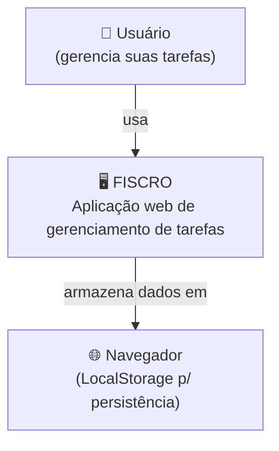
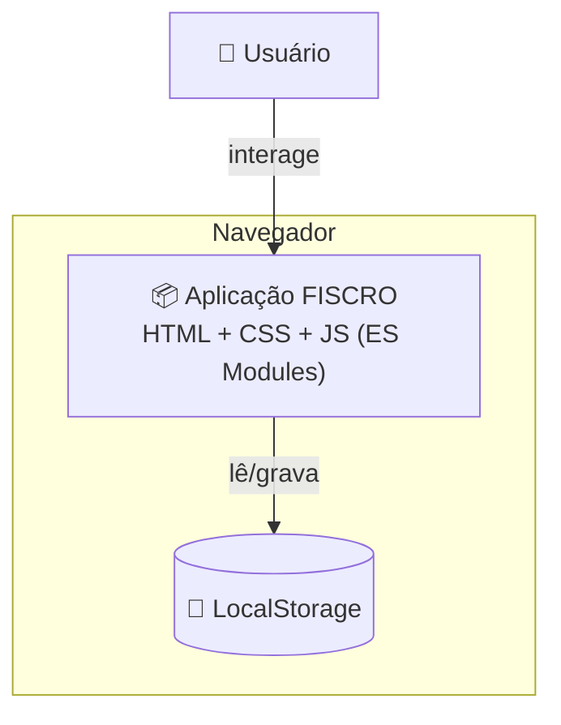
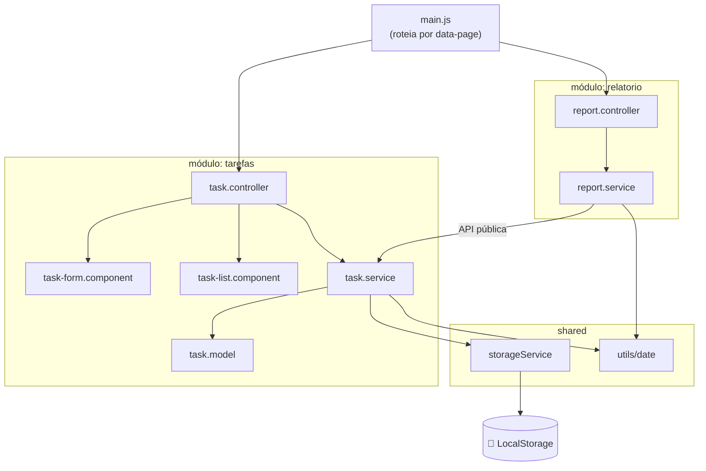

# Modelo C4 — FISCRO

Documentação visual da arquitetura no [modelo C4](https://c4model.com/) (Simon Brown), nos
níveis proporcionais a este projeto: **Contexto**, **Contêiner** e **Componentes**. Os
diagramas usam Mermaid e renderizam diretamente no GitHub.

## Nível 1 — Contexto

Quem usa o sistema e com o que ele se relaciona.

## Nível 2 — Contêiner

O FISCRO é um único contêiner: uma aplicação estática servida ao navegador. Não há
back-end nem banco de dados dedicados (ver [ADR-0002](decisions/0002-front-end-estatico-vanilla-es-modules.md)
e [ADR-0004](decisions/0004-persistencia-localstorage-com-abstracao.md)).

## Nível 3 — Componentes

Organização interna como **monólito modular particionado por domínio**
(ver [ADR-0003](decisions/0003-monolito-modular-particionado-por-dominio.md)).

> Observação de governança: `relatorio` depende de `tarefas` **apenas pela API pública**
> (`task.service`) e a dependência é **acíclica** — regra verificada pela fitness function
> FF-02 (ver [fitness-functions.md](fitness-functions.md)).
