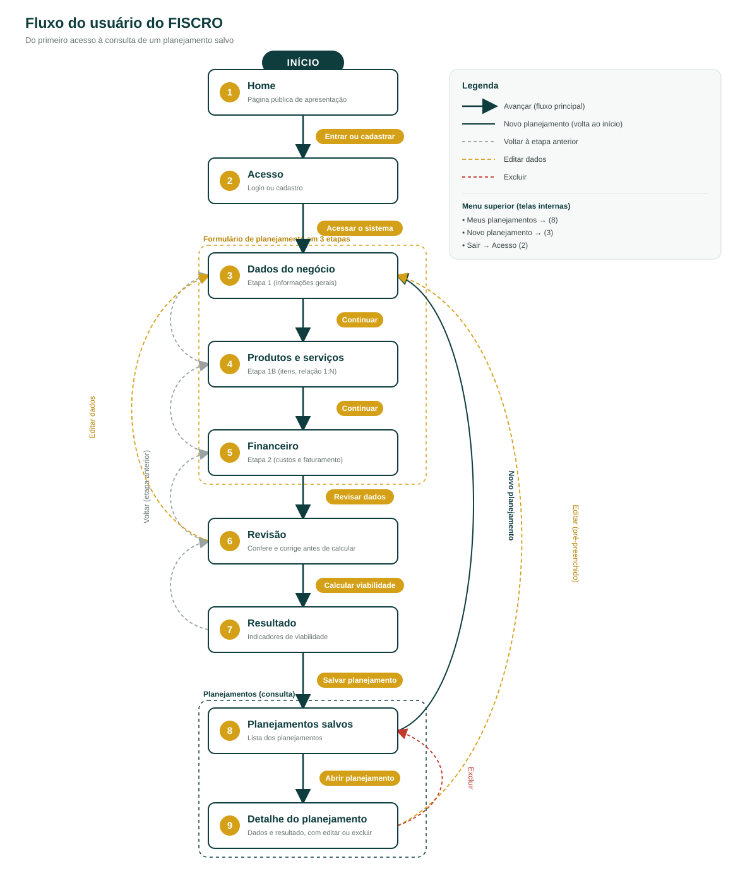
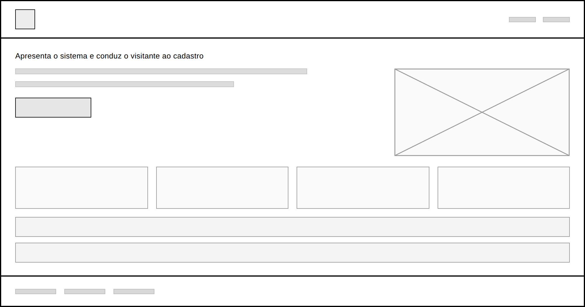
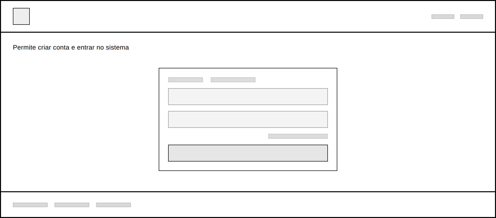
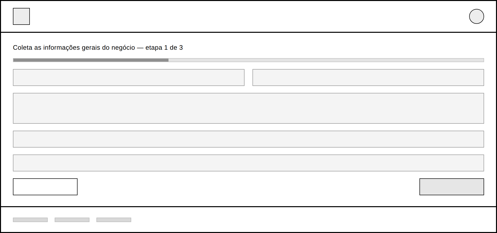
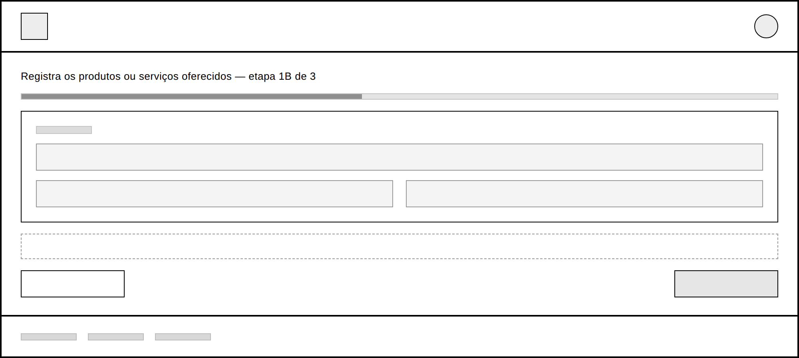
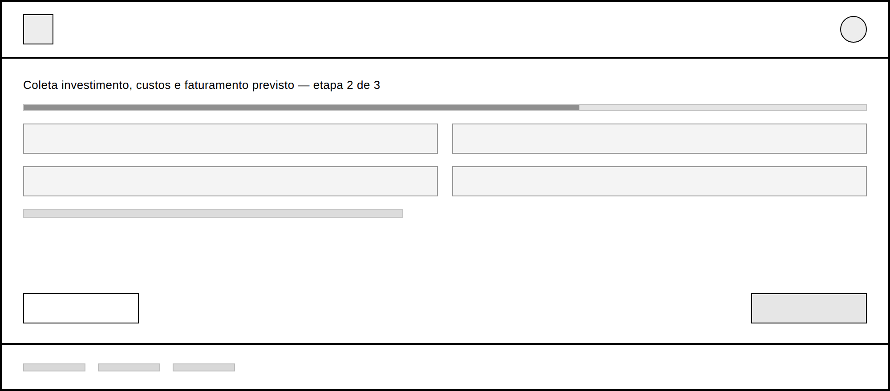
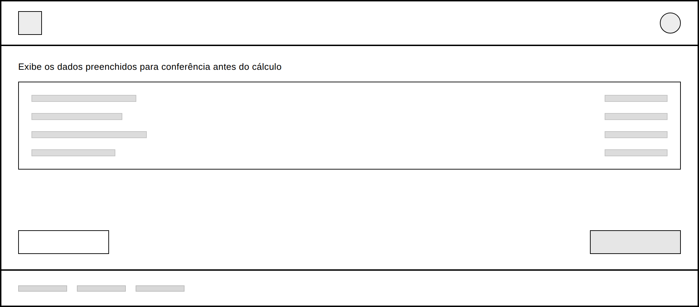
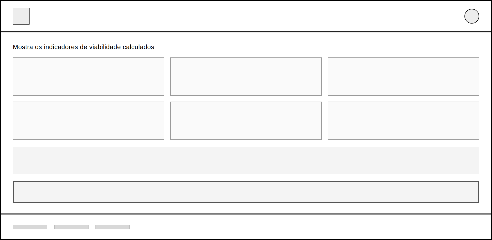
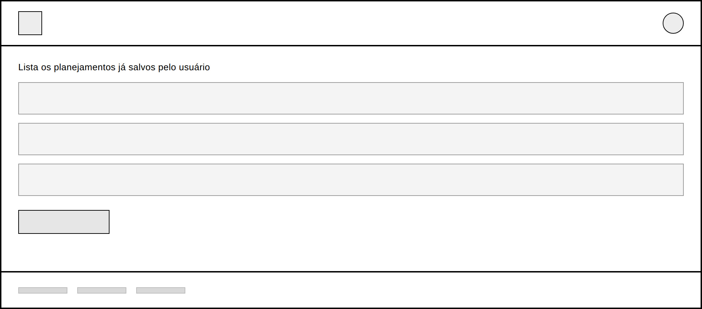
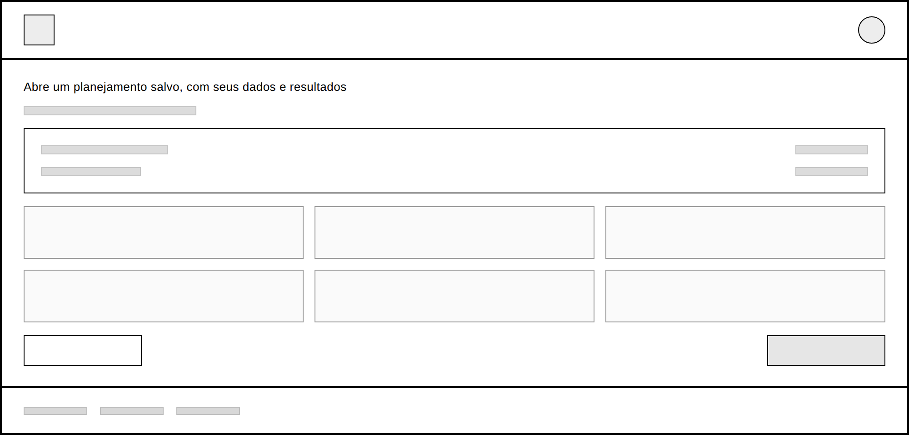

# Projeto de Interface

O FISCRO é um sistema de apoio à criação e ao planejamento estratégico de pequenos negócios. A partir dos dados informados pelo empreendedor (informações gerais do negócio, produtos e serviços oferecidos e dados financeiros), o sistema calcula indicadores de viabilidade e apresenta um resumo do planejamento, que pode ser salvo e consultado depois.

A interface foi projetada para ser simples e sequencial: o usuário avança por etapas curtas, revisa o que preencheu antes de calcular e recebe os resultados em uma tela única. Todas as telas seguem o mesmo padrão estrutural, com cabeçalho, conteúdo e rodapé, garantindo consistência visual e previsibilidade na navegação.

## User Flow

O diagrama abaixo mostra o caminho do usuário pelo sistema, do primeiro acesso até a consulta de um planejamento salvo.

O percurso principal é linear: a partir da Home, o usuário se autentica e preenche o formulário em três etapas (dados do negócio, produtos e serviços, dados financeiros). Antes do cálculo, a tela de Revisão permite conferir e corrigir o que foi informado. Calculada a viabilidade, o resultado pode ser salvo e consultado a qualquer momento na lista de planejamentos, onde cada item abre sua própria tela de detalhe.

## Wireframes

### 1. Home

Primeira tela do sistema, acessível sem autenticação. Apresenta o que o FISCRO faz, destaca os principais recursos e conduz o visitante ao cadastro. Também reúne as perguntas frequentes e um canal de contato.

### 2. Login / Cadastro

Concentra o acesso ao sistema em uma única tela, com alternância entre entrar e criar conta. Inclui recuperação de senha. É o ponto de entrada obrigatório para as telas seguintes.

### 3. Dados do negócio

Primeira etapa do formulário de planejamento. Coleta as informações gerais do negócio: nome, segmento, descrição da ideia, público-alvo e concorrentes. O indicador de progresso mostra ao usuário em que ponto do preenchimento ele está.

### 4. Produtos e serviços

Segunda parte da primeira etapa. Registra o que o negócio oferece, com preço e volume estimado por item, permitindo adicionar quantos itens forem necessários. Foi mantida separada da tela anterior por representar uma relação 1:N com o negócio.

### 5. Financeiro

Segunda etapa do formulário. Reúne investimento inicial, custos fixos, custos variáveis e faturamento projetado, que são os dados que alimentam o cálculo de viabilidade. Campos sem valor exato podem ser deixados em branco.

### 6. Revisão

Etapa final antes do cálculo. Exibe em uma única tela tudo o que foi preenchido, sinaliza campos obrigatórios ausentes e permite voltar para corrigir antes de prosseguir.

### 7. Resultado

Apresenta o resumo do planejamento com os indicadores calculados: receita, custo, lucro, ponto de equilíbrio, margem de segurança e retorno do investimento. Traz explicações dos termos e alerta quando a margem indica risco, deixando claro que os valores são estimativas.

### 8. Planejamentos salvos

Lista os planejamentos já criados pelo usuário e dá acesso a cada um deles. É também o ponto de partida para iniciar um novo planejamento.

### 9. Detalhe do planejamento

Abre um planejamento salvo com seus dados e resultados, permitindo editá-lo ou excluí-lo.

