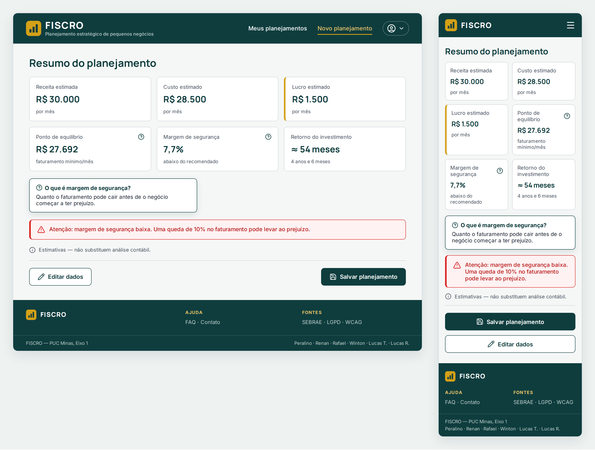
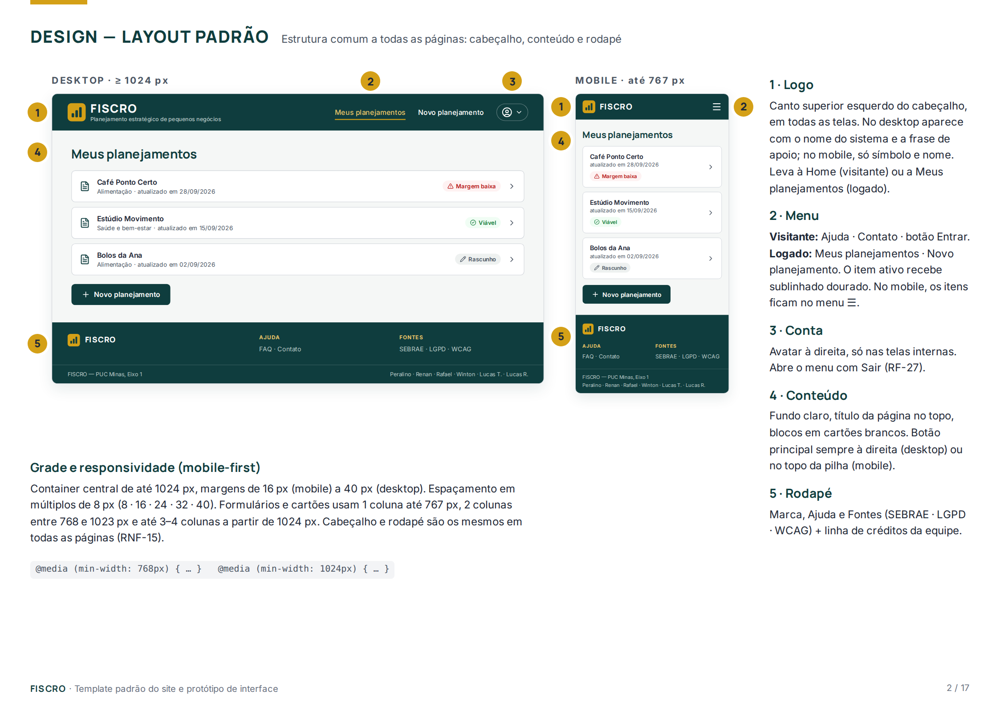
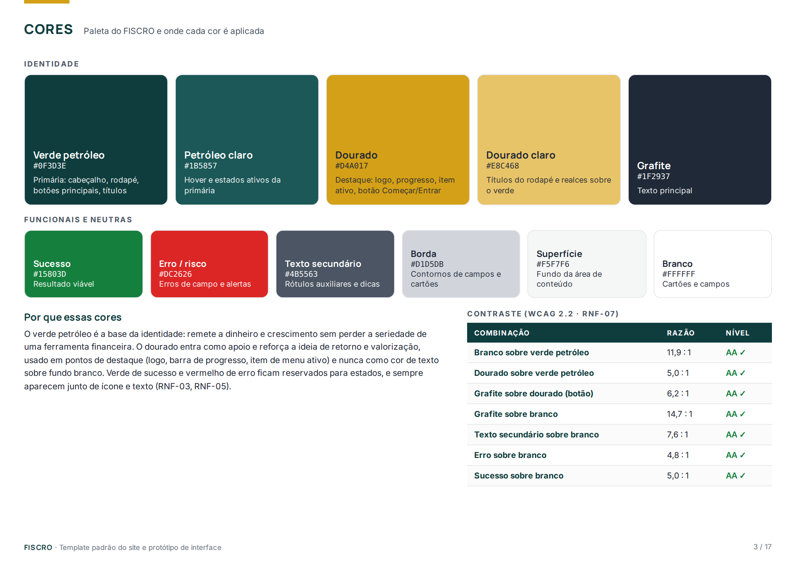
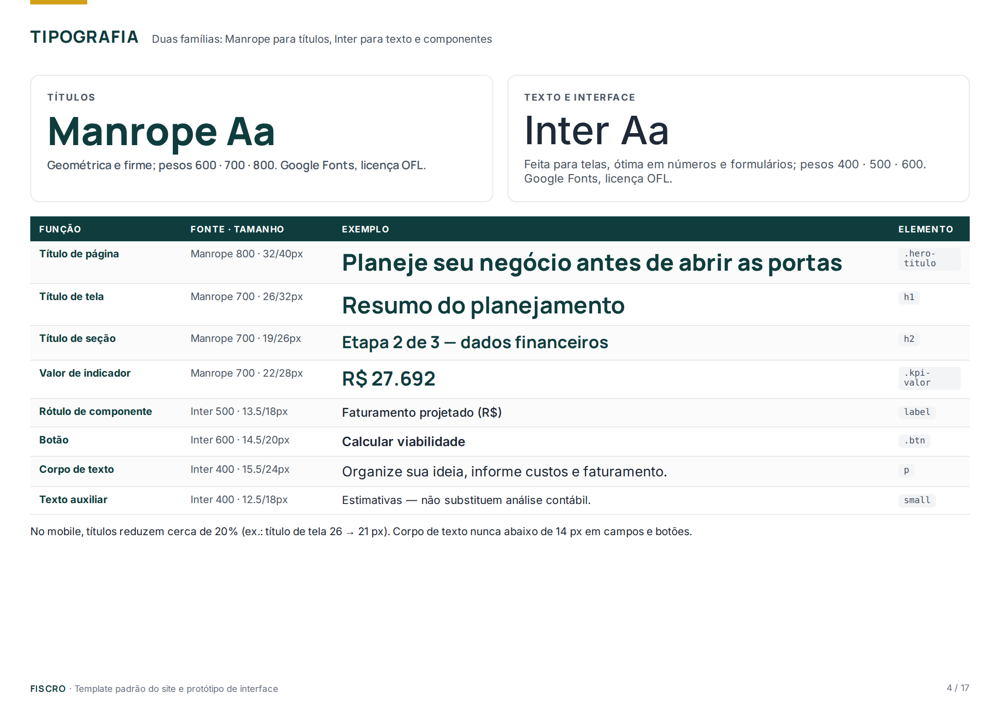
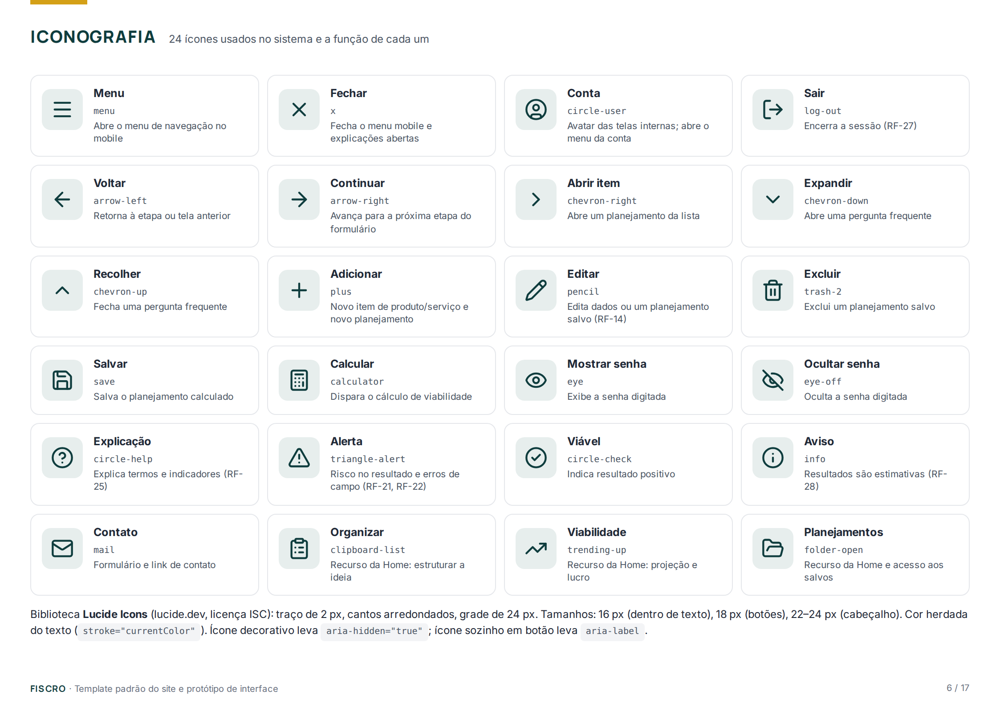
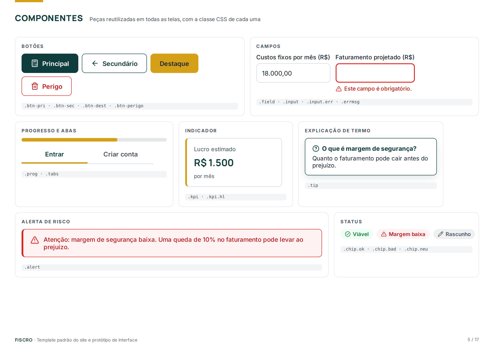

# Template padrão do site

O template padrão define a estrutura, a identidade visual e os componentes que se repetem em todas as páginas do FISCRO. Ele garante que o usuário encontre sempre os mesmos elementos no mesmo lugar (logo, menu, botões, alertas e rodapé), o que torna a navegação previsível e atende ao requisito de consistência visual (RNF-15).

O layout é construído em HTML5 e CSS3 com abordagem *mobile-first*: a versão para celular é a base, e a partir dos pontos de quebra de 768 px e 1024 px a página ganha colunas e espaçamento. Cores, fontes e raios de borda ficam centralizados em variáveis CSS, de modo que qualquer ajuste de identidade é feito em um único lugar.

A página escolhida para ilustrar o template é a de **Resultado**, por reunir a maior parte dos componentes do sistema: cabeçalho logado, cartões de indicadores, explicação de termo, alerta de risco, aviso de estimativa e botões de ação.



O documento completo, com o guia de estilo e as 9 telas em desktop e mobile anotadas com os requisitos funcionais, está em [FISCRO-Template.pdf](FISCRO-Template.pdf).

## Design

Todas as páginas seguem a mesma estrutura em três faixas: **cabeçalho**, **conteúdo** e **rodapé**.



1. **Logo** — fica no canto superior esquerdo do cabeçalho, em todas as telas. No desktop aparece com o nome do sistema e a frase de apoio; no mobile, apenas o símbolo e o nome. Ao ser clicado, leva à Home (visitante) ou à lista de planejamentos (usuário logado).
2. **Menu** — para visitantes: *Ajuda*, *Contato* e o botão *Entrar*. Para usuários logados: *Meus planejamentos* e *Novo planejamento*. O item da página atual recebe sublinhado dourado. No mobile, os itens ficam recolhidos no menu ☰.
3. **Conta** — nas telas internas, o avatar à direita abre o menu da conta com a opção *Sair* (RF-27).
4. **Conteúdo** — fundo claro, título da página no topo e informações organizadas em cartões brancos. O botão principal fica sempre à direita no desktop e no topo da pilha no mobile. Formulários longos são divididos em etapas com barra de progresso.
5. **Rodapé** — marca, links de ajuda, fontes de apoio (SEBRAE, LGPD, WCAG) e créditos da equipe.

**Grade e responsividade:** container central de até 1024 px; margens de 16 px (mobile) a 40 px (desktop); espaçamentos em múltiplos de 8 px. Formulários e cartões usam 1 coluna até 767 px, 2 colunas entre 768 e 1023 px e até 3 ou 4 colunas a partir de 1024 px.

## Cores

A identidade visual combina **verde petróleo** e **dourado**, apoiados por um grafite para texto e por cores funcionais reservadas a estados.

O verde petróleo é a cor principal: remete a dinheiro e crescimento sem perder a seriedade esperada de uma ferramenta financeira, e aparece no cabeçalho, no rodapé, nos títulos e nos botões principais. O dourado funciona como cor de apoio e reforça a ideia de retorno e valorização; por isso é usado em pontos de destaque (logo, barra de progresso, item de menu ativo e botão de entrada), e nunca como cor de texto sobre fundo branco. O verde de sucesso e o vermelho de erro aparecem somente para indicar estados e sempre acompanhados de ícone e texto, para que a informação não dependa só da cor (RNF-03 e RNF-05).



| Cor | Hex | Uso |
|---|---|---|
| Verde petróleo | `#0F3D3E` | Cor primária: cabeçalho, rodapé, títulos, botões principais |
| Petróleo claro | `#1B5857` | Hover e estados ativos da cor primária |
| Dourado | `#D4A017` | Destaque: logo, barra de progresso, item ativo, botão Entrar/Começar |
| Dourado claro | `#E8C468` | Títulos do rodapé e realces sobre o verde |
| Grafite | `#1F2937` | Texto principal |
| Texto secundário | `#4B5563` | Rótulos auxiliares e dicas |
| Sucesso | `#15803D` | Resultado viável |
| Erro / risco | `#DC2626` | Erros de campo e alertas |
| Superfície | `#F5F7F6` | Fundo da área de conteúdo |
| Borda | `#D1D5DB` | Contorno de campos e cartões |

Todas as combinações de texto usadas atingem contraste mínimo de 4,5:1, conforme a WCAG 2.2 nível AA (RNF-07). Exemplos: branco sobre verde petróleo (11,9:1), grafite sobre dourado (6,2:1) e erro sobre branco (4,8:1).

## Tipografia

O sistema usa duas famílias do Google Fonts, ambas com licença livre (OFL): **Manrope** para títulos e valores de destaque, por ser geométrica e firme, e **Inter** para textos, rótulos e botões, por ter ótima legibilidade em telas, principalmente em números e formulários.



| Função | Fonte | Peso | Tamanho / altura de linha |
|---|---|---|---|
| Título de página (Home) | Manrope | 800 | 32 / 40 px |
| Título de tela | Manrope | 700 | 26 / 32 px |
| Título de seção | Manrope | 700 | 19 / 26 px |
| Valor de indicador | Manrope | 700 | 22 / 28 px |
| Rótulo de componente | Inter | 500 | 13,5 / 18 px |
| Botão | Inter | 600 | 14,5 / 20 px |
| Corpo de texto | Inter | 400 | 15,5 / 24 px |
| Texto auxiliar | Inter | 400 | 12,5 / 18 px |

No mobile, os títulos são reduzidos em cerca de 20% (título de tela passa de 26 para 21 px). Textos de campos e botões nunca ficam abaixo de 14 px.

## Iconografia

Os ícones vêm da biblioteca **[Lucide Icons](https://lucide.dev)** (licença ISC): traço de 2 px, cantos arredondados e grade de 24 px, o que combina com o estilo das fontes e dos botões. A cor do ícone é herdada do texto (`stroke="currentColor"`). Os tamanhos padrão são 16 px dentro de textos, 18 px em botões e 22 a 24 px no cabeçalho.



| Ícone | Nome no código | Função |
|---|---|---|
| Menu | `menu` | Abre o menu de navegação no mobile |
| Fechar | `x` | Fecha o menu mobile e explicações abertas |
| Conta | `circle-user` | Avatar das telas internas; abre o menu da conta |
| Sair | `log-out` | Encerra a sessão (RF-27) |
| Voltar | `arrow-left` | Retorna à etapa ou tela anterior |
| Continuar | `arrow-right` | Avança para a próxima etapa do formulário |
| Abrir item | `chevron-right` | Abre um planejamento da lista |
| Expandir / Recolher | `chevron-down` / `chevron-up` | Abre e fecha uma pergunta frequente |
| Adicionar | `plus` | Novo produto/serviço e novo planejamento |
| Editar | `pencil` | Edita dados ou um planejamento salvo (RF-14) |
| Excluir | `trash-2` | Exclui um planejamento salvo |
| Salvar | `save` | Salva o planejamento calculado |
| Calcular | `calculator` | Dispara o cálculo de viabilidade |
| Mostrar / Ocultar senha | `eye` / `eye-off` | Exibe ou oculta a senha digitada |
| Explicação | `circle-help` | Explica termos e indicadores (RF-25) |
| Alerta | `triangle-alert` | Risco no resultado e erros de campo (RF-21, RF-22) |
| Viável | `circle-check` | Indica resultado positivo |
| Aviso | `info` | Informa que os resultados são estimativas (RF-28) |
| Contato | `mail` | Formulário e link de contato |
| Organizar / Viabilidade / Planejamentos | `clipboard-list` / `trending-up` / `folder-open` | Recursos apresentados na Home |

Ícones decorativos recebem `aria-hidden="true"`; um ícone usado sozinho em um botão recebe `aria-label` com a ação. Nenhum estado é indicado só por ícone: ele sempre vem acompanhado de texto. A lista completa, com tamanhos e cores permitidas, está em [FISCRO-Icones.pdf](FISCRO-Icones.pdf).

## Componentes e estilos CSS

Os componentes abaixo são reutilizados em todas as telas.

!

**Variáveis globais** — definidas uma única vez e usadas por todos os componentes:

```css
:root {
  --cor-primaria: #0F3D3E;
  --cor-primaria-hover: #1B5857;
  --cor-destaque: #D4A017;
  --cor-destaque-claro: #E8C468;
  --cor-texto: #1F2937;
  --cor-texto-sec: #4B5563;
  --cor-fundo: #FFFFFF;
  --cor-superficie: #F5F7F6;
  --cor-borda: #D1D5DB;
  --cor-sucesso: #15803D;
  --cor-erro: #DC2626;
  --cor-erro-texto: #B91C1C;
  --cor-erro-fundo: #FEF2F2;
  --fonte-titulo: 'Manrope', system-ui, sans-serif;
  --fonte-texto: 'Inter', system-ui, sans-serif;
  --raio: 8px;
}
```

**Estrutura e botões:**

```css
body { font-family: var(--fonte-texto); color: var(--cor-texto); background: var(--cor-superficie); }
h1, h2 { font-family: var(--fonte-titulo); color: var(--cor-primaria); }

.cabecalho { background: var(--cor-primaria); color: #fff; display: flex;
  align-items: center; justify-content: space-between; height: 60px; padding: 0 16px; }
.menu a.ativo { border-bottom: 2px solid var(--cor-destaque); color: var(--cor-destaque-claro); }
.rodape { background: var(--cor-primaria); color: #B7C9C7; }

.btn { display: inline-flex; align-items: center; gap: 8px; height: 44px; padding: 0 20px;
  border-radius: var(--raio); font-weight: 600; border: 1.5px solid transparent; }
.btn-primario   { background: var(--cor-primaria); color: #fff; }
.btn-primario:hover { background: var(--cor-primaria-hover); }
.btn-secundario { background: #fff; color: var(--cor-primaria); border-color: var(--cor-primaria); }
.btn-destaque   { background: var(--cor-destaque); color: var(--cor-texto); }
.btn-perigo     { background: #fff; color: var(--cor-erro-texto); border-color: var(--cor-erro); }

@media (min-width: 1024px) {
  .cabecalho { height: 76px; padding: 0 32px; }
}
```

**Formulários, cartões e alertas:**

```css
.campo input { height: 44px; border: 1px solid var(--cor-borda); border-radius: var(--raio); padding: 0 12px; }
.campo input:focus { outline: 2px solid var(--cor-primaria); outline-offset: 2px; }
.campo.erro input { border: 2px solid var(--cor-erro); }
.mensagem-erro { color: var(--cor-erro-texto); font-size: 12.5px; }

.progresso { height: 8px; border-radius: 999px; background: #E3E8E7; }
.progresso > span { display: block; height: 100%; border-radius: 999px; background: var(--cor-destaque); }

.cartao { background: #fff; border: 1px solid var(--cor-borda); border-radius: var(--raio); padding: 24px; }
.indicador-valor { font-family: var(--fonte-titulo); font-size: 22px; font-weight: 700; color: var(--cor-primaria); }

.alerta { background: var(--cor-erro-fundo); border: 1px solid var(--cor-erro);
  border-left: 4px solid var(--cor-erro); border-radius: var(--raio); color: var(--cor-erro-texto); padding: 14px 16px; }
```

> **Links úteis**
> - [Lucide Icons](https://lucide.dev)
> - [Google Fonts — Manrope](https://fonts.google.com/specimen/Manrope) · [Inter](https://fonts.google.com/specimen/Inter)
> - [WCAG 2.2 — Contraste mínimo](https://www.w3.org/TR/WCAG22/#contrast-minimum)
> - [Adobe Color](https://color.adobe.com/pt/create/color-wheel)
